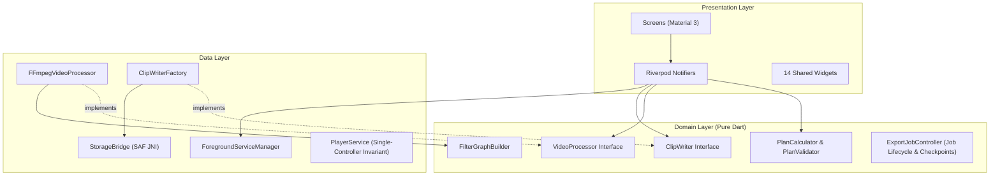

# ShortsSplitter Architecture Documentation

Complete architectural blueprint of ShortsSplitter: layers, module boundaries, data flows, and strict isolation rules.

---

## Table of Contents
1. [Core Architectural Principles](#1-core-architectural-principles)
2. [Layer Separation & Dependency Invariant](#2-layer-separation--dependency-invariant)
3. [Feature-First Directory Organization](#3-feature-first-directory-organization)
4. [FFmpeg Isolation Boundary](#4-ffmpeg-isolation-boundary)
5. [End-to-End Data Flow & Sequence Diagram](#5-end-to-end-data-flow--sequence-diagram)
6. [Component Architecture Diagram](#6-component-architecture-diagram)
7. [Native Platform Bridges & Foreground Services](#7-native-platform-bridges--foreground-services)

---

## 1. Core Architectural Principles

ShortsSplitter follows **Feature-First Clean Architecture** with unidirectional data flow powered by **Riverpod** and declarative routing via **GoRouter**.

### Non-Negotiable Invariants
1. **Inward Dependencies:** Presentation depends on Domain; Data depends on Domain. The Domain layer has zero external dependencies on Flutter UI frameworks or native platform plugins.
2. **FFmpeg Encapsulation:** Native FFmpeg (`ffmpeg_kit_flutter_new`) is strictly isolated inside a single file: `lib/features/processing/data/ffmpeg_video_processor.dart`.
3. **Memory Safety:** Videos are never loaded into memory as `Uint8List`. Processing operates strictly one clip at a time. Content URIs are streamed via 64KB chunks through temporary disk pipes.
4. **Declarative Navigation:** Navigation operates exclusively through typed route paths declared in `AppRoutes` (`lib/app/constants.dart`).

---

## 2. Layer Separation & Dependency Invariant

```
┌──────────────────────────────────────────────────────────┐
│                   Presentation Layer                     │
│  - Screens (Dashboard, Trimmer, PlanReview, Player, etc) │
│  - Riverpod Notifiers & AsyncNotifiers                   │
│  - 14 Reusable UI Primitives (lib/shared/widgets/)       │
└────────────────────────────┬─────────────────────────────┘
                             │ (depends on)
                             ▼
┌──────────────────────────────────────────────────────────┐
│                      Domain Layer                        │
│  - Entities & Value Objects (ClipPlan, TrimRange, Specs) │
│  - Pure Mathematical Algorithms (PlanCalculator)         │
│  - Invariant Validators (PlanValidator - 180s cap)       │
│  - Abstract Interfaces (VideoProcessor, ClipWriter)      │
└────────────────────────────▲─────────────────────────────┘
                             │ (implements)
┌────────────────────────────┴─────────────────────────────┐
│                       Data Layer                         │
│  - FFmpegVideoProcessor (Concrete FFmpegKit runner)      │
│  - ClipWriterFactory (4-tier storage strategy)           │
│  - Repositories (HistoryRepository, OutputRepository)    │
│  - StorageBridge & ForegroundServiceManager              │
└──────────────────────────────────────────────────────────┘
```

---

## 3. Feature-First Directory Organization

The codebase is organized into vertical, self-contained business slices:

```
lib/
├── main.dart                                    # App entry point, ProviderScope initialization
├── app/                                         # Core app infrastructure
│   ├── constants.dart                           # Durations, presets, storage keys, AppRoutes
│   ├── constants/
│   │   └── app_strings.dart                     # Centralized user-facing UI copy
│   ├── router.dart                              # GoRouter with ShellRoute & Onboarding redirect
│   ├── theme.dart                               # Material 3 dynamic theme & accent providers
│   └── theme/
│       ├── app_colors.dart                      # 5 creator accent seeds (red, violet, ocean, emerald, orange)
│       └── app_tokens.dart                      # Zero-magic-number design tokens (spacing, radii, durations)
├── core/                                        # Domain-agnostic foundation
│   ├── errors/
│   │   ├── app_exception.dart                   # Typed exception hierarchy
│   │   └── error_mapper.dart                    # Technical exception to user message converter
│   ├── logger/
│   │   └── app_logger.dart                      # Tagged, level-filtered logging
│   ├── result/
│   │   └── result.dart                          # Functional Result<T, E> algebraic type
│   └── utils/
│       ├── foreground_service_manager.dart      # Platform channel bridge to ExportForegroundService
│       ├── formatters.dart                      # Timestamp and file size formatters
│       ├── permission_utils.dart                # Android 9-15+ permission checkers
│       ├── storage_bridge.dart                  # Platform channel bridge to native SAF operations
│       └── storage_utils.dart                   # Directory probing and path utilities
├── features/                                    # Vertical feature modules
│   ├── audio_studio/                            # Audio Studio (multi-track mixer, voice-over, ducking)
│   │   ├── data/audio_recording_service.dart    # MethodChannel bridge to native MediaRecorder
│   │   ├── domain/
│   │   │   ├── audio_studio_compiler.dart       # Multi-track mixing, adelay, sidechain ducking
│   │   │   └── models/audio_studio_project.dart # AudioTrack, AudioStudioConfig, AudioTrackType
│   │   └── presentation/
│   │       ├── controllers/audio_studio_controller.dart
│   │       └── screens/audio_studio_screen.dart # 4-state mixer UI with timeline level bars
│   ├── create/                                  # Creation wizard steps 1 & 2
│   │   └── presentation/screens/
│   │       ├── select_video_screen.dart         # Video selection & technical inspection
│   │       └── trim_screen.dart                 # Timeline scrubber & millisecond range trimmer
│   ├── convert/                                 # Format Convert & Compression tool
│   │   ├── domain/
│   │   │   ├── convert_filter_compiler.dart     # FFmpeg args compiler for video, GIF, audio
│   │   │   └── models/convert_config.dart       # Formats, resolutions, fps, CRF & target MB
│   │   └── presentation/
│   │       ├── controllers/convert_controller.dart
│   │       └── screens/convert_screen.dart      # Format chips, compression presets & estimator
│   ├── custom_split/                            # Custom Split tool (no 180s cap, 4 modes)
│   │   ├── domain/
│   │   │   ├── custom_split_calculator.dart     # Mathematical segmentation engine
│   │   │   └── models/                          # CustomSplitConfig, CustomClipPlan, CustomClipItem
│   │   └── presentation/
│   │       ├── controllers/custom_split_controller.dart
│   │       └── screens/                         # CustomSplitScreen, CustomSplitPlanReviewScreen
│   ├── editor/                                  # Studio Video Editor (1-pass transcode)
│   │   ├── domain/
│   │   │   ├── editor_filter_compiler.dart      # Complex 1-pass filter graph compiler
│   │   │   └── models/edit_project.dart         # Non-destructive EditProject specification
│   │   └── presentation/
│   │       ├── controllers/editor_controller.dart
│   │       └── screens/editor_screen.dart       # 6-dock tool editor with 5s quick preview
│   ├── history/                                 # Project records & search
│   │   ├── data/shared_prefs_history_repository.dart
│   │   ├── domain/
│   │   │   ├── history_repository.dart
│   │   │   └── models/project_record.dart
│   │   └── presentation/
│   │       ├── controllers/history_controller.dart
│   │       ├── screens/history_screen.dart
│   │       └── widgets/history_project_card.dart
│   ├── home/                                    # Dashboard hub
│   │   ├── domain/models/dashboard_stats.dart
│   │   └── presentation/
│   │       ├── controllers/dashboard_controller.dart
│   │       ├── home_screen.dart
│   │       ├── screens/dashboard_screen.dart
│   │       └── widgets/                         # Greeting, StatsGrid, CreatorTips, StudioToolsGrid
│   ├── jobs/                                    # Unified Sequential Job Queue
│   │   ├── domain/
│   │   │   ├── job_queue_controller.dart        # Unified background execution & recovery
│   │   │   └── models/job_record.dart           # JobType (7 tools), JobStatus, JobRecord
│   │   └── presentation/screens/jobs_screen.dart # 4-state job queue screen with tabbed filters
│   ├── merge/                                   # Video Merge tool (join, reorder, transitions)
│   │   ├── domain/
│   │   │   ├── merge_filter_compiler.dart       # Fast concat args, complex xfade & aspect normalization
│   │   │   └── models/merge_project.dart        # MergeConfig, MergeClipItem, Canvas presets, transitions
│   │   └── presentation/
│   │       ├── controllers/merge_controller.dart # Reordering, duplicate, trim, canvas/transition state
│   │       ├── screens/merge_screen.dart        # 4-state reorderable clip list and settings UI
│   │       └── widgets/                         # MergeSummaryCard, MergeClipTile, MergeSettingsCard, MergeTrimDialog
│   ├── onboarding/                              # First-run experience
│   │   └── presentation/
│   │       ├── controllers/onboarding_controller.dart
│   │       └── screens/onboarding_screen.dart
│   ├── output/                                  # 4-tier storage writers & results
│   │   ├── data/
│   │   │   ├── clip_writer_factory.dart
│   │   │   ├── output_repository.dart
│   │   │   └── writers/                         # Saf, MediaStore, Direct, AppExternal writers
│   │   ├── domain/
│   │   │   ├── clip_writer.dart
│   │   │   └── models/                          # ExportedClip, StorageStrategy
│   │   └── presentation/
│   │       ├── controllers/output_controller.dart
│   │       └── screens/results_screen.dart
│   ├── plan_review/                             # Step 4: Plan inspection & editing
│   │   ├── presentation/
│   │   │   ├── controllers/plan_controller.dart
│   │   │   ├── screens/plan_review_screen.dart
│   │   │   └── widgets/                         # PlanHeader, PartCard, EditBoundaryDialog
│   ├── player/                                  # Dedicated sequence video player
│   │   └── presentation/screens/
│   │       └── video_player_screen.dart
│   ├── processing/                              # FFmpeg transcode orchestrator
│   │   ├── data/
│   │   │   ├── ffmpeg_video_processor.dart      # ONLY permitted FFmpegKit import
│   │   │   └── overlay_renderer.dart            # dart:ui PNG text badge rasterizer
│   │   ├── domain/
│   │   │   ├── audio_graph_builder.dart         # Pure Dart audio graph & atempo compiler
│   │   │   ├── filter_graph_builder.dart        # FFmpeg -vf / -filter_complex generator
│   │   │   ├── models/                          # ProcessingProgress, VideoMetadata
│   │   │   └── video_processor.dart             # Abstract transcode contract
│   │   └── presentation/
│   │       ├── controllers/processing_controller.dart
│   │       └── screens/processing_screen.dart
│   ├── screenshot/                              # Screenshot Capture tool
│   │   ├── domain/
│   │   │   ├── models/screenshot_config.dart    # ScreenshotConfig, ScreenshotItem, formats, modes
│   │   │   └── screenshot_compiler.dart         # FFmpeg args compiler with -frames:v 1 and -q:v
│   │   └── presentation/
│   │       ├── controllers/screenshot_controller.dart
│   │       ├── screens/screenshot_screen.dart   # Scrubber player, modes, session gallery strip
│   │       └── widgets/screenshot_preview_dialog.dart # Full-screen viewer with zoom/pan/share/save
│   ├── settings/                                # Preferences & cache cleaner
│   │   └── presentation/
│   │       ├── controllers/settings_controller.dart
│   │       └── screens/settings_screen.dart
│   ├── split_config/                            # Cut presets, canvas specs, overlays
│   │   ├── domain/models/                       # CanvasSpec, OverlaySpec, ClipPlan, PlanCalculator
│   │   └── presentation/
│   │       ├── controllers/split_config_controller.dart
│   │       ├── screens/split_config_screen.dart
│   │       └── widgets/                         # AspectRatioSelector, OverlaySettingsCard
│   ├── utility/                                 # Shared error & rationale screens
│   │   └── presentation/
│   │       ├── screens/                         # GlobalErrorScreen, UnsupportedVideoScreen
│   │       └── widgets/                         # PermissionRationaleSheet
│   └── video_picker/                            # Video picking repository & doubles
└── shared/widgets/                              # 14 Reusable UI primitives
    ├── app_scaffold.dart                        # Adaptive shell (NavigationBar / NavigationRail)
    ├── clip_tile.dart
    ├── color_picker_field.dart
    ├── confirm_dialog.dart
    ├── empty_state.dart
    ├── error_state.dart
    ├── info_banner.dart
    ├── loading_skeleton.dart
    ├── primary_button.dart
    ├── progress_ring.dart
    ├── secondary_button.dart
    ├── section_card.dart
    ├── settings_tile.dart
    └── stat_tile.dart
```

---

## 4. FFmpeg Isolation Boundary

ShortsSplitter uses `ffmpeg_kit_flutter_new` (pinned at `^4.6.8`). To prevent vendor lock-in and enable instant headless unit testing:

- **Strict Containment:** The package `package:ffmpeg_kit_flutter_new/` is imported exclusively inside:
  ```
  lib/features/processing/data/ffmpeg_video_processor.dart
  ```
- **Domain Decoupling:** All business operations interact with media manipulation strictly via the abstract `VideoProcessor` interface (`lib/features/processing/domain/video_processor.dart`).
- **Headless Unit Testing:** All tests inject `FakeVideoProcessor` (`test/fakes/fake_video_processor.dart`), enabling 100% of unit and widget tests to execute in seconds without spawning heavy C/C++ native processes.

---

## 5. End-to-End Data Flow & Sequence Diagram

The flow from picking a video to finalizing exported clips:

```mermaid
sequenceDiagram
    autonumber
    actor User
    participant Picker as SelectVideoScreen
    participant Trim as TrimScreen
    participant Config as SplitConfigScreen
    participant Plan as PlanReviewScreen
    participant Proc as ProcessingScreen
    participant Engine as FFmpegVideoProcessor
    participant Writer as ClipWriter (SAF)
    participant Results as ResultsScreen

    User->>Picker: Selects source video
    Picker->>Trim: Opens Trimmer with duration & metadata
    User->>Trim: Adjusts RangeSlider handles (e.g. 0:00 to 3:00)
    Trim->>Config: Passes TrimRange
    User->>Config: Sets 60s target, 9:16 Blur Background, Auto Part Badge
    Config->>Plan: Generates ClipPlan via PlanCalculator
    User->>Plan: Reviews parts; adjusts boundary or merges remainder
    User->>Proc: Taps "Export Shorts"

    Proc->>Proc: Starts Android Foreground Service (ExportForegroundService)
    loop For each ClipPart (1..N)
        Proc->>Engine: splitVideo(part, canvasSpec, overlaySpec)
        Engine->>Engine: Rasterizes badge to PNG via OverlayRenderer
        Engine->>Engine: Executes FFmpeg with FilterGraphBuilder pipeline
        Engine-->>Proc: Yields live Stream<ProcessingProgress>
        Proc-->>User: Updates radial ProgressRing & notification bar
        Engine-->>Writer: Writes temp file to app-private cache
        Writer->>Writer: Copies into destination (SAF Tree URI / MediaStore)
        Writer->>Writer: Deletes temp file
    end
    Proc->>Proc: Stops Foreground Service & persists ProjectRecord
    Proc->>Results: Navigates to /results
    Results->>User: Displays exported sequence with full preview & share
```

---

## 6. Component Architecture Diagram



---

## 7. Native Platform Bridges & Foreground Services

ShortsSplitter integrates with native Android OS capabilities via three MethodChannels:

1. **`StorageBridge` (`com.shortssplitter.shorts_splitter/storage_bridge`):**
   - Implemented in Kotlin: `android/app/src/main/kotlin/.../StorageBridge.kt`.
   - Handles `takePersistableUriPermission` validation, SAF directory existence verification, document creation, and output streaming via `DocumentFile`.
2. **`ForegroundServiceManager` (`com.shortssplitter.shorts_splitter/foreground_service`):**
   - Implemented in Kotlin: `android/app/src/main/kotlin/.../ExportForegroundService.kt`.
   - Starts `FOREGROUND_SERVICE_MEDIA_PROCESSING` (with fallback to `dataSync` on Android 14), maintaining continuous CPU execution via `WAKE_LOCK` and posting real-time progress updates in the notification shade.
3. **`AudioRecorderBridge` (`com.shortssplitter.shorts_splitter/audio_recorder`):**
   - Implemented in Kotlin: `android/app/src/main/kotlin/.../AudioRecorderBridge.kt`.
   - Native microphone recording using Android's `MediaRecorder` API (AAC, 44.1kHz, 192kbps), with start/stop/duration methods, zero third-party pub dependencies, and full API 28 through API 35+ support.

---

## 8. Local Embedded Database (Drift SQLite) & Two-Stage Pipeline

ShortsSplitter incorporates an embedded, typed, reactive SQLite architecture powered by **Drift** (`drift: ^2.31.0` + `sqlite3_flutter_libs`):

### Schema Design & Foreign Key Cascades
- **`sources`:** Unique media fingerprint (`SourceFingerprint`), technical metadata (resolution, fps, duration, size), content URI or file path.
- **`projects`:** Foreign key to `sources(id)` with `ON DELETE CASCADE`. Stores workflow type (`two_stage` or `single_step`), trim range, output layout, settings snapshot JSON, and timestamps.
- **`parts`:** Foreign key to `projects(id)` with `ON DELETE CASCADE`. Stores planned and actual cut boundaries, granular lifecycle stages (`planned`, `split`, `converted`), status (`idle`, `queued`, `running`, `failed`), `hasCapViolation`, `isStale`, and `isMissing`.
- **`jobs` & `job_events`:** Background execution state, progress tracking, and detailed error/status logging.
- **`app_settings`:** Key-value system configurations.

### Two-Stage Workflow Architecture
1. **Stage 1 "Fast Split":** Single-pass stream copy (`-c copy`) segment split for long videos into a designated subfolder (`FolderLayoutResolver`). Cuts snap to nearest keyframes; actual cut boundaries and durations are probed and updated in `parts`. Parts exceeding 180s cap are flagged with `hasCapViolation`.
2. **Stage 2 "Convert to Shorts":** Selective transcoding for user-chosen parts from the parts review screen. Transcoded output safely replaces raw split parts via `SafeClipReplacer` (write to temp -> verify integrity -> write staged document beside target -> verify -> atomic delete/rename with full rollback preserving the raw clip on any error).
3. **Reactive UI Streaming:** The presentation layer subscribes to Drift queries via domain repositories (`watchAllProjects()`, `watchPartsForProject()`), ensuring instantaneous UI reflection with zero polling. Granular per-row progress is throttled to 4 Hz via `ProgressTracker` and isolated through `partProgressProvider(index)`.

