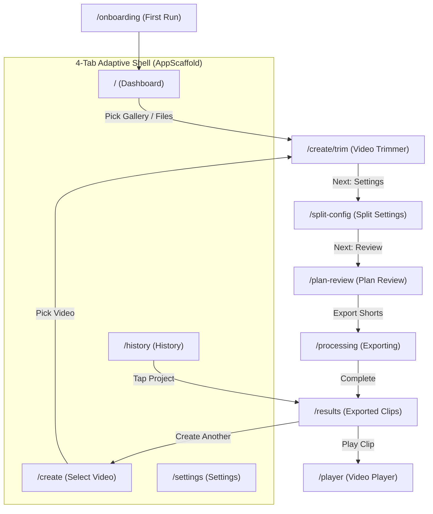

# ShortsSplitter UI & Design System Guide

Comprehensive reference for the ShortsSplitter design tokens, 14 reusable UI widgets, screen inventory, navigation flow, and accessibility requirements.

---

## Table of Contents
1. [Screen Inventory & Route Map](#1-screen-inventory--route-map)
2. [Navigation Flow Diagram (Mermaid)](#2-navigation-flow-diagram-mermaid)
3. [Design Tokens (AppTokens)](#3-design-tokens-apptokens)
4. [Color System & Themes](#4-color-system--themes)
5. [The 14 Reusable Shared Widgets](#5-the-14-reusable-shared-widgets)
6. [The 4 Mandatory Screen States](#6-the-4-mandatory-screen-states)
7. [Accessibility & Motion Compliance](#7-accessibility--motion-compliance)
8. [Centralized Messaging & Validation UX (AppMessenger)](#8-centralized-messaging--validation-ux-appmessenger)
9. [Selective Clip Processing UI & Status Badging](#9-selective-clip-processing-ui--status-badging)

---

## 1. Screen Inventory & Route Map

Routes are declared in `AppRoutes` (`lib/app/constants.dart`) and wired through `GoRouter` (`lib/app/router.dart`):

| Screen | Route Path | Route Name | Type | Key Responsibility |
| :--- | :--- | :--- | :--- | :--- |
| **Dashboard** | `/` | `home` | Shell Tab 0 | Greeting, creation card, stats grid, recent projects, tips carousel. |
| **Select Video** | `/create` | `create` | Shell Tab 1 | Gallery and file picker, media specs preview. |
| **History** | `/history` | `history` | Shell Tab 2 | Past project records, search, multi-select, swipe-to-delete with undo. |
| **Settings** | `/settings` | `settings` | Shell Tab 3 | Output directory, naming pattern, duplicate mode, theme, cache cleaner. |
| **Onboarding** | `/onboarding` | `onboarding` | Standalone | 3-step feature tour with storage directory selection. |
| **Trim Video** | `/create/trim` | `create-trim` | Standalone | RangeSlider timeline trimmer, precision time fields, quick trim chips. |
| **Split Config** | `/split-config` | `split-config` | Standalone | Clip length presets, canvas aspect ratio, background, overlay badge. |
| **Plan Review** | `/plan-review` | `plan-review` | Standalone | Summary metrics, editable boundaries, remainder merge toggle. |
| **Processing** | `/processing` | `processing` | Standalone | Radial ProgressRing, per-clip status, elapsed/remaining timers. |
| **Results** | `/results` | `results` | Standalone | Sequence clip list, preview launcher, open folder, share all. |
| **Video Player** | `/player` | `player` | Standalone | Full-screen player with speed selector (1x, 1.5x, 2x), next/prev clip. |
| **Global Error** | `/error` | `error` | Standalone | Generic error fallback with retry and return home buttons. |
| **Unsupported** | `/unsupported` | `unsupported` | Standalone | Detailed guidance when video codec or container is unsupported. |

---

## 2. Navigation Flow Diagram (Mermaid)



---

## 3. Design Tokens (AppTokens)

All spacing, corner radii, elevations, and durations are centralized in `lib/app/theme/app_tokens.dart`. **Zero magic numbers** are permitted in presentation widgets.

### Spacing Scale
- `AppTokens.spaceXs`: `4.0` dp
- `AppTokens.spaceSm`: `8.0` dp
- `AppTokens.spaceMd`: `12.0` dp
- `AppTokens.spaceLg`: `16.0` dp
- `AppTokens.spaceXl`: `24.0` dp
- `AppTokens.spaceXxl`: `32.0` dp

### Corner Radii
- `AppTokens.borderRadiusSm`: `8.0` dp
- `AppTokens.borderRadiusMd`: `12.0` dp
- `AppTokens.borderRadiusLg`: `16.0` dp
- `AppTokens.borderRadiusXl`: `24.0` dp
- `AppTokens.borderRadiusFull`: `999.0` dp

### Breakpoints & Elevations
- `AppTokens.breakpointCompact`: `600.0` dp (threshold between NavigationBar and NavigationRail).
- `AppTokens.minTouchTarget`: `48.0` dp.
- `AppTokens.elevationSm` (1), `elevationMd` (3), `elevationLg` (6).

---

## 4. Color System & Themes

ShortsSplitter implements Material 3 dynamic color theming supporting:
- **Theme Modes:** `ThemeMode.system`, `ThemeMode.light`, `ThemeMode.dark`.
- **5 Creator Accent Seeds (`AppAccentColor`):**
  - **Red:** `#FF0000` (YouTube Brand Red)
  - **Violet:** `#7C3AED` (Creative / Studio)
  - **Ocean:** `#0284C7` (Modern Tech)
  - **Emerald:** `#059669` (Fresh / Dynamic)
  - **Orange:** `#EA580C` (Energy / Action)

---

## 5. The 14 Reusable Shared Widgets

Located in `lib/shared/widgets/`:

1. **`AppScaffold`:** Responsive shell providing bottom `NavigationBar` on phones and vertical `NavigationRail` on screens $\ge 600\text{dp}$.
2. **`SectionCard`:** Container card with standard padding, header title, optional icon, and trailing action.
3. **`PrimaryButton`:** Full-width or inline filled action button with loading spinner and disabled state.
4. **`SecondaryButton`:** Outlined action button for auxiliary actions.
5. **`StatTile`:** Metric summary tile displaying formatted counts and subtle background icon.
6. **`EmptyState`:** Centered placeholder with themed icon, title, description, and primary action.
7. **`ErrorState`:** Error graphic, message text, and retry button callback.
8. **`LoadingSkeleton`:** Pulsing card and tile placeholders respecting `disableAnimations`.
9. **`ProgressRing`:** Radial progress ring with percentage readout, step tracker, and pulse animations.
10. **`InfoBanner`:** Contextual notification banner supporting `info`, `warning`, and `error` variants.
11. **`ClipTile`:** Formatted clip row with preview thumbnail, index badge, share, and delete actions.
12. **`ColorPickerField`:** Color swatch selector for solid canvas backgrounds.
13. **`SettingsTile`:** Standardized row with leading icon, title, subtitle, and trailing switch or dropdown.
14. **`ConfirmDialog`:** Unified confirmation dialog for destructive actions (delete, discard, cancel).

---

## 6. The 4 Mandatory Screen States

Every screen consuming asynchronous data must handle all four states explicitly via Riverpod's `AsyncValue.when(...)`:

```dart
stateAsync.when(
  loading: () => LoadingSkeleton.card(),
  error: (err, stack) => ErrorState(
    message: err.toString(),
    onRetry: () => controller.refresh(),
  ),
  data: (items) {
    if (items.isEmpty) {
      return EmptyState(
        icon: Icons.video_library_outlined,
        title: 'No Items',
        message: 'Get started by creating your first split.',
        actionLabel: 'Create',
        onAction: () => context.go(AppRoutes.create),
      );
    }
    return ContentWidget(items: items);
  },
);
```

---

## 7. Accessibility & Motion Compliance

1. **Minimum Touch Targets:** Every button and interactive control meets or exceeds `48x48dp` (`AppTokens.minTouchTarget`).
2. **WCAG AA Contrast:** Normal text maintains $\ge 4.5:1$ contrast against container backgrounds; large text maintains $\ge 3:1$.
3. **Reduced Motion:** Infinite pulsing animations in `LoadingSkeleton` inspect:
   ```dart
   MediaQuery.maybeDisableAnimationsOf(context) ?? false
   ```
   Animations halt immediately if the user has enabled "Reduce Motion" in system settings.
4. **Font Scaling:** Layouts tolerate system font scaling up to **200%** without text clipping or overflow errors.

---

## 8. Centralized Messaging & Validation UX (`AppMessenger`)

ShortsSplitter provides a unified notification and messaging service (`AppMessenger` in `lib/shared/services/app_messenger.dart`) to eliminate fragmented, inconsistent snackbars and silent failures.

### Capabilities & Specifications
- **Severity-Based Visual Design:**
  - `ValidationSeverity.error`: Error container theme color with `Icons.error_outline_rounded` (4s duration).
  - `ValidationSeverity.warning`: Amber tone with `Icons.warning_amber_rounded` (3s duration).
  - `ValidationSeverity.success`: Forest green tone with `Icons.check_circle_outline_rounded` (2s duration).
  - `ValidationSeverity.info`: Inverse surface tone with `Icons.info_outline_rounded` (2s duration).
- **Rapid Deduplication:** Automatically suppresses identical consecutive messages fired within `1500ms`.
- **Accessible Screen Reader Announcement:** Emits `SemanticsService.announce` for screen reader accessibility on every message.
- **Actionable Buttons:** Supports contextual action callbacks (e.g. `Choose Folder`, `Open Settings`, `Undo`).
- **Input Validation Pattern:** Action buttons remain interactive and tappable. On tap, validation runs:
  1. Displays the first validation error through `AppMessenger.showIssue`.
  2. Renders field-level inline error styling under the affected input.
  3. Scrolls the viewport smoothly to ensure the offending control is visible.

---

## 9. Selective Clip Processing UI & Status Badging

ShortsSplitter provides visual selection controls and lifecycle chips across the creation and history workflows.

### Plan Review Screen (`/plan-review`)
- **Selection Action Bar:** Rendered above the clip list:
  - Checkbox count badge: `X of Y selected` (e.g. `3 of 30 selected`).
  - Action buttons: `Select All`, `Deselect`, `Invert`.
  - Dynamic Export Button: `Create 30 Shorts` $\rightarrow$ `Create 3 of 30 Shorts (60.0s)` $\rightarrow$ `Select parts to process`.
- **Part Tiles (`PlanPartTile`):**
  - Interactive leading Checkbox for each clip.
  - Lifecycle chips:
    - `Processed`: Green container with check icon.
    - `Not processed`: Subtle outline chip.
    - `Processing`: Primary tone with live spinning circular progress indicator.
    - `Failed (Retry)`: Error tone with warning icon and single-tap retry.
    - `Modified`: Amber tone indicating altered boundaries or text overlay.
    - `Missing`: Red outline indicating file deleted from storage.

### Results Screen (`/results`)
- Fully exported sequences render standard `ClipTile` items with Preview, Share, and Delete actions.
- Partially exported plans display finished clips alongside dimmed unprocessed parts featuring a direct `Process` button.
- Bottom action row includes a `Process Remaining (X clips)` button navigating directly to Plan Review.

### History Screen (`/history`) & Dashboard
- Projects with partial exports display a `X/Y processed` badge (e.g. `3/30 processed`) alongside a mini `LinearProgressIndicator`.
- Fully completed exports display standard short counts (`30 shorts • Shorts 9:16`).

---

## 10. Split Settings & Layout Alignment Controls (`FitLayout`)

### Split Settings Screen (`/split-config`)
- **Canvas & Alignment (`CanvasSelector`):**
  - **Vertical Position:** `Center` (default, symmetric top/bottom bands), `Top` (pinned to top edge), `Bottom` (pinned to bottom edge).
  - **Fine-Tuning Offset Slider:** `Manual Vertical Offset (-20% to +20%)` with quick `Reset` chip.
- **Part Messages & Overlay (`OverlaySettingsCard`):**
  - **Part Label Mode Segmented Button:**
    - `Auto` (default): Emits label only for multi-part plans; hides on 1-clip conversions.
    - `Always`: Always emits part label on all clips.
    - `Never`: Disables auto numbering.
  - **7 Overlay Positions:** `Top-Left`, `Top-Center`, `Top-Right`, `Center`, `Bottom-Left`, `Bottom-Center`, `Bottom-Right`.
- **Naming & Prefix Card:**
  - Configures base prefix and single-clip naming mode (`Name only` vs `With suffix`).

### Plan Review Screen (`/plan-review`)
- **Single-Part Smart Detection:** Displays info banner `"Your video fits in 1 short. No splitting needed!"` and bottom action button `"Create 1 Short (XX.Xs)"`.
- **Live Overlay Preview (`OverlayLivePreview`):** Accurately reflects exact `FitLayout` integer coordinates, video dimensions, vertical position, and offset.
- **Part Message Dialog (`PartMessageDialog`):** Provides a 3-way override selector (`Default`, `Show`, `Hide`) alongside custom message tokens.


